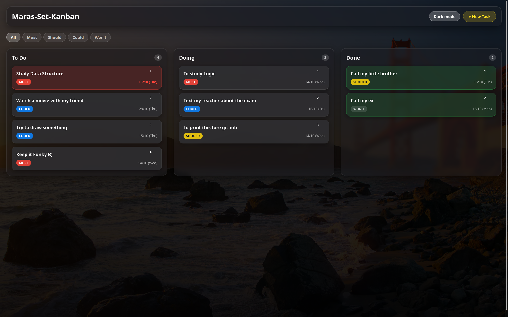

# Maras-Set-Kanban

A personal Kanban board built with plain HTML, CSS and JavaScript, no frameworks and no build step. Tasks move through three columns (To Do, Doing, Done), carry a MoSCoW priority and a due date, and are saved in the browser.

Built as a 14-day front-end study project (30 minutes a day), with a 7-day backend phase planned for the future, and with the interface inspired by Apple's Human Interface Guidelines and its "Liquid Glass" look.



**Live demo:** https://o-maranhao.github.io/maras-set-kanban/

## Features

- Three columns: To Do, Doing and Done, each with a task counter
- Create, edit and delete tasks (click a card to edit it)
- Drag and drop between columns, and to reorder cards inside a column
- MoSCoW priority (Must, Should, Could, Won't) with color-coded badges
- Due dates, with overdue tasks highlighted
- Filter the board by priority
- Light and dark theme: follows the system setting until you pick one with the toggle, and remembers your choice
- Wallpaper picker: photos from the `Wallpapers` folder, three gradient presets or your own image, remembered across visits
- Tasks persist in `localStorage`
- Responsive layout for tablets and phones
- Smooth animations for new, moved and deleted cards, filter changes and theme switching (disabled when the system asks for reduced motion)

## Run it

No installation needed. Clone the repository and open `index.html` in a browser:

```
git clone https://github.com/O-Maranhao/maras-set-kanban.git
cd maras-set-kanban
```

Or serve the folder locally:

```
python3 -m http.server 8000
```

Then open `http://localhost:8000`.

## Project structure

```
index.html      Page structure
style.css       Layout, glass effect, themes, typography and animations
script.js       Data model, rendering, drag and drop, filters and theme
wallpapers.js   List of wallpaper images shown in the picker
golden-gate.jpg Default wallpaper
Wallpapers/     More wallpaper images
docs/           Screenshots used in this README
```

## How it works

- **Data model:** each task is `{ id, title, description, column, priority, dueDate }`. The board is rendered from a single `tasks` array, so every change (add, edit, move, delete, filter) updates the array and re-renders.
- **Persistence:** the array is saved to `localStorage` after every render.
- **Theming:** the theme lives in a `data-theme` attribute on `<html>`. A small inline script applies it before the first paint to avoid a flash.
- **Design:** type scale, system colors and contrast follow Apple's Human Interface Guidelines.

## Adding wallpapers

Put the `.jpg` in the `Wallpapers` folder and add one line for it to `wallpapers.js`, with the file name exactly as it is on disk.
Keep images under about 1MB and roughly 1920px wide, so the page stays fast.

## What I learned

- Building UI state around a single source of truth (the `tasks` array) instead of editing the DOM by hand
- The HTML5 drag and drop API and its quirks
- CSS cascade and specificity, custom properties, `backdrop-filter` and theming with attributes
- Why some effects (like the glass blur) break inside browser view transitions, and how to design around it
- Accessibility basics: contrast, focus, and respecting `prefers-reduced-motion`

## Roadmap

The next phase adds a backend:

- Python with FastAPI, SQLModel and SQLite
- A REST API for tasks, replacing `localStorage`
- Deploy of the backend (Render or Railway)

## Future improvements

- A description field in the task form (the data model and cards already support it)
- A column selector in the edit form, for easier use on touch screens

## License

This is a personal study project. Add a license here if you plan to share it.